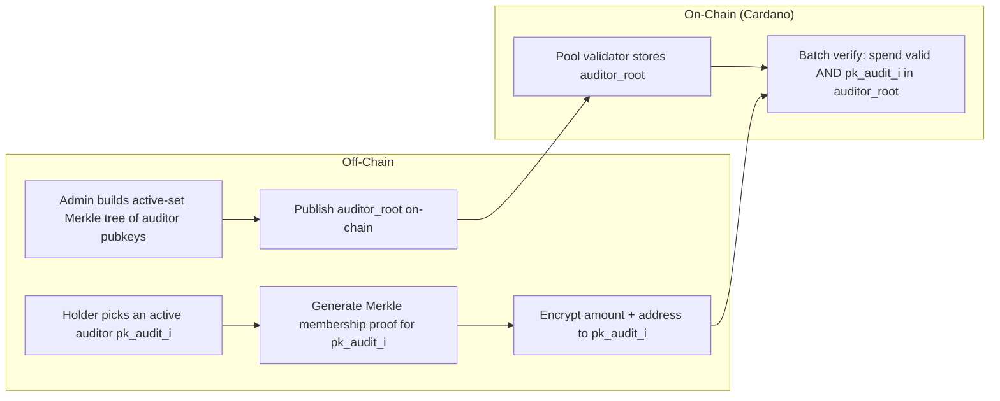

# Step 10 — Dynamic Multi-Auditor Privacy Pool with Full Reveal

> **One-line summary:** Step 6's multi-user batch pool, but the single hard-coded auditor is replaced by a **dynamic active-set of auditors**.  Each spend encrypts amount + recipient address to one auditor chosen from a Merkle tree of active auditor public keys, and the circuit proves the chosen auditor is currently active.  Auditors can join after setup, and an auditor can lose function by removing its key from the active set.

---

## What Step 10 adds

| | Step 6 (single fixed auditor) | **Step 10 (dynamic multi-auditor)** |
|---|---|---|
| **Auditor set** | 1 hard-coded `pk_audit` | **N auditors** in a Merkle active-set |
| **Join after setup** | ❌ needs new circuit | **✅** admin inserts new key → new `auditor_root` |
| **Replace auditor** | ❌ needs new circuit | **✅** admin rebuilds tree → new `auditor_root` |
| **Revoke auditor** | ❌ impossible | **✅** remove key from tree → new `auditor_root` |
| **Holder choice** | fixed | **any active auditor** |
| **Proof size** | 192 B | 192 B (same) |
| **Extra constraints** | — | ~1K per auditor-tree level |

The cryptographic reveal is unchanged from Step 5/6:

```
E     = r * G
C     = in_amount   * H + r * pk_audit
C_a0  = addr_limb0  * H + r * pk_audit
C_a1  = addr_limb1  * H + r * pk_audit
```

Only the holder of `sk_audit` for the chosen `pk_audit` can decrypt that spend.

---

## Architecture



### Active-set Merkle tree

Each auditor public key is hashed to a leaf:

```
leaf_i = Poseidon(pk_audit_i.x, pk_audit_i.y)
auditor_root = MerkleRoot(leaf_0, leaf_1, ..., leaf_{N-1})
```

The circuit verifies:

```
PoseidonMerklePath(
    leaf = Poseidon(pk_audit[0], pk_audit[1]),
    root = auditor_root,
    sibling[auditor_depth],
    direction[auditor_depth]
)
```

### Operational lifecycle

| Action | Off-chain | On-chain effect |
|---|---|---|
| **Setup** | build tree with initial auditors | `auditor_root` in pool datum |
| **New auditor joins** | insert new pubkey → recompute root | update pool datum root |
| **Auditor replaced** | remove old, insert new → recompute root | update pool datum root |
| **Auditor revoked** | remove pubkey → recompute root | update pool datum root |
| **Spend** | pick active auditor, prove membership | gate checks root matches datum |

### Important limitation: forward secrecy

Twisted ElGamal ciphertexts are posted on-chain.  Revoking an auditor stops
**future** spends from using that key, but the revoked auditor can still
decrypt **past** ciphertexts they received.  If retroactive privacy is
required, combine this step with Step 8's proxy re-encryption to rotate
historical ciphertexts to a new auditor key.

---

## Run

### Groth16

```bash
./groth16_e2e.sh
```

Overrides: `DEPTH=`, `AUDITOR_DEPTH=`, `USERS=`, `SPENDS=`, `AUDITORS=`, `SEED=`, `OUT=`.

```bash
# 8 users, 4 auditors, deeper trees
USERS=8 AUDITORS=4 DEPTH=6 AUDITOR_DEPTH=4 ./groth16_e2e.sh
```

### NovaSlim

```bash
./novaslim_e2e.sh
```

Requires the upstream `nova-slim` CLI at `../../nova-slim/cli/target/release/nova-slim`.

---

## Circuits

| File | Purpose |
|---|---|
| `circom/PrivacyPool/privacy_pool_viewable_addr_dynamic.circom` | Groth16 spend circuit: Step 3 pool + multi-message ElGamal + auditor active-set membership |
| `circom/PrivacyPool/elgamal_viewkey_addr_dynamic_nova.circom` | Nova IVC step: multi-message ElGamal + auditor active-set membership |
| `circom/PrivacyPool/gen_multi_viewable_addr_dynamic_input.py` | Witness + scenario generator; builds the auditor Merkle tree and assigns a random active auditor per spend |

---

## On-chain

| Path | Verifier | Extra datum field |
|---|---|---|
| Groth16 | `aiken/groth16` gate (pairing check) | `auditor_root` |
| NovaSlim | `nova-slim/cardano/nova-slim-verifier` | `auditor_root` |

The gate must ensure the public `auditor_root` input equals the root stored in
the pool datum.  Updating the root is an admin action separate from the ZK
proof verification.

---

## Public inputs per spend (Groth16)

```
merkle_root, nullifier_hash, out_commitment_1, out_commitment_2,
fee, pk_audit[2], addr_commitment, auditor_root
```

plus public outputs `E[2], C[2], C_a0[2], C_a1[2]`.

---

## Representative timing (dev machine)

| Phase | Groth16 (depth 4, 4 users, 4 auditors) | NovaSlim (1 step) |
|---|---|---|
| compile | ~9 s | ~2 s |
| witness | ~2 s per user | ~1 s |
| trusted setup | ~35 s | — (transparent) |
| prove / fold+compress | ~17 s per user | ~30 + ~55 s |
| verify | ~0.13 s total (batch) | ~0.01 s |
| **proof size** | **192 B** | **~758 B** |

Constraint count for the Groth16 circuit is ~35K non-linear constraints at
depth 4 / auditor-depth 4 (Step 6 was ~34K; the auditor membership proof adds
~1K constraints).

---

## Comparison with Step 7 revocation

Step 7 revokes **credentials** with a Sparse Merkle Tree non-membership proof.
Step 10 manages **auditors** with a Merkle membership proof.  The pattern is
directly analogous:

| | Step 7 (credentials) | Step 10 (auditors) |
|---|---|---|
| Registry | revocation SMT | active-set Merkle tree |
| Proof type | non-membership | membership |
| Admin action | insert revoked credential | insert/remove auditor key |
| Result | credential becomes unusable | auditor loses spend-decrypt function |

Because the holder can choose any active auditor, the system also naturally
supports jurisdictional or role-based auditor sets (e.g., EU auditor, US
auditor, internal auditor) without circuit changes.

---

## Future extensions

- **Threshold auditor committee:** encrypt to a k-of-n aggregate public key so
  no single auditor can decrypt alone.
- **Proxy re-encryption rotation:** use Step 8 primitives to re-encrypt past
  ciphertexts when an auditor is replaced, closing the forward-secrecy gap.
- **Per-jurisdiction auditor roots:** one root per regulatory regime; the holder
  proves membership in the relevant regime's tree.
