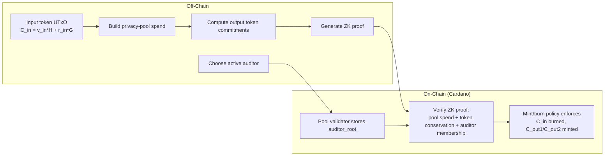

# Step 11 — Private Token Lifecycle inside a Selective-Disclosure Vehicle

> **One-line summary:** Step 10's dynamic-auditor privacy pool, but now every spend is bound to real Pedersen token commitments.  The circuit proves that the confidential token value is conserved across the spend, linking a CIP-113-style private token (value hidden in the datum) to the privacy pool.

---

## What Step 11 adds

| | Step 10 (dynamic auditors) | **Step 11 (token lifecycle)** |
|---|---|---|
| **Asset** | Abstract pool note | **Pedersen token commitment** |
| **Token conservation** | In pool-note arithmetic only | **Also in token commitments** |
| **Mint/burn semantics** | None | **Input commitment → two output commitments** |
| **Ledger view** | Nothing identifiable | **Token UTxOs with commitments** |
| **Proof path** | Groth16 + NovaSlim | **Groth16** (NovaSlim planned) |
| **Constraints** | ~35K | **~58K** |

The cryptographic building blocks are unchanged from Steps 5/10:

```
Token commitment:  C_token = value * H + blinding * G
Auditor encryption: C      = amount * H + r * pk_audit
```

The new proof statement is:

```
token_in_value  = token_out1_value + token_out2_value + fee
in_amount       = token_in_value
out_amount_1    = token_out1_value
out_amount_2    = token_out2_value
```

---

## Architecture



### Token-layer public inputs

Each spend exposes three Pedersen commitments as public inputs:

```
token_in_commitment[2]      = C_in
token_out_commitment_1[2]   = C_out1
token_out_commitment_2[2]   = C_out2
```

The contract can then enforce the mint/burn policy:

- the input token UTxO (carrying `C_in`) is burned,
- exactly two output token UTxOs (carrying `C_out1`, `C_out2`) are minted.

Because the proof already shows `C_in`, `C_out1`, `C_out2` open to values that satisfy
conservation, the contract never learns the actual values.

---

## Run

### Groth16

```bash
./groth16_e2e.sh
```

Overrides: `DEPTH=`, `AUDITOR_DEPTH=`, `USERS=`, `SPENDS=`, `AUDITORS=`, `SEED=`, `OUT=`.

```bash
# 4 users, 4 auditors, deeper trees
USERS=8 AUDITORS=4 DEPTH=6 AUDITOR_DEPTH=4 ./groth16_e2e.sh
```

### NovaSlim

A NovaSlim step circuit for Step 11 is planned but not yet included.  The token
conservation logic can be folded into the same step structure as Step 10's
`elgamal_viewkey_addr_dynamic_nova.circom`.

---

## Circuits

| File | Purpose |
|---|---|
| `circom/PrivacyPool/pedersen_commit.circom` | Reusable Pedersen commitment `C = v*H + r*G` over JubJub |
| `circom/PrivacyPool/privacy_pool_token_lifecycle.circom` | Groth16 circuit combining pool spend, token conservation, dynamic auditor, and auditor encryption |
| `circom/PrivacyPool/gen_token_lifecycle_input.py` | Witness generator; builds auditor tree and binds token commitments to pool amounts |

---

## On-chain

| Path | Verifier | Extra checks |
|---|---|---|
| Groth16 | `aiken/groth16` gate (pairing check) | `auditor_root` matches datum; token mint/burn matches public commitments |
| NovaSlim | planned | — |

The gate must ensure:

1. The public `auditor_root` equals the root stored in the pool datum.
2. The public `token_in_commitment`, `token_out_commitment_1`, `token_out_commitment_2`
   match the token UTxOs being burned/minted.

---

## Public inputs per spend (Groth16)

```
merkle_root, nullifier_hash, out_commitment_1, out_commitment_2, fee,
pk_audit[2], addr_commitment, auditor_root,
token_in_commitment[2], token_out_commitment_1[2], token_out_commitment_2[2]
```

plus public outputs `E[2], C[2], C_a0[2], C_a1[2]`.

---

## Representative timing (dev machine)

| Phase | Groth16 (depth 4, 2 users, 3 auditors) |
|---|---|
| compile | ~10 s |
| witness | ~2.8 s per user |
| trusted setup | ~59 s |
| prove | ~26 s per user |
| verify | ~0.13 s total (batch) |
| **proof size** | **192 B** |

Constraint count at depth 4 / auditor-depth 4: **~58K non-linear constraints**.

---

## Relationship to CIP-113 private tokens

Step 11 is the bridge to CIP-113-style confidential assets:

| CIP-113 concept | Step 11 implementation |
|---|---|
| Token quantity visible, real value in datum | Pool note + Pedersen commitment in datum |
| Pedersen commitments sum under mint/burn | `token_in = token_out1 + token_out2 + fee` in R1CS |
| Encrypted value for receiver | Twisted ElGamal to auditor (viewing-key model) |
| ZK proof of correctness | Groth16 over BLS12-381 |

The next extension would be to replace the privacy-pool Merkle tree with the
actual CIP-113 minting policy, so the contract enforces both the asset policy
and the confidentiality proof in one validator.

---

## Future extensions

- **NovaSlim step circuit** for token lifecycle conservation.
- **CIP-113 policy integration** — burn/mint the actual native asset and check
  the policy ID in the redeemer.
- **Receiver decryption** — include a one-time DH key in the datum so the
  recipient can decrypt the value, mirroring the CIP-113 approach.
- **Compliance hooks** — freeze, whitelist, and supply-cap checks at the token
  policy layer, separate from the privacy proof.
