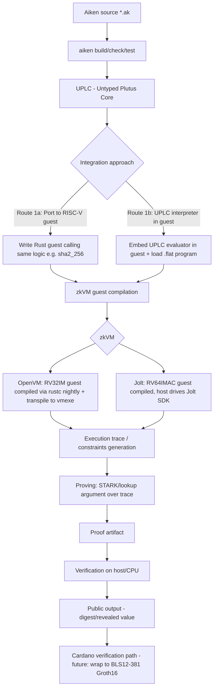
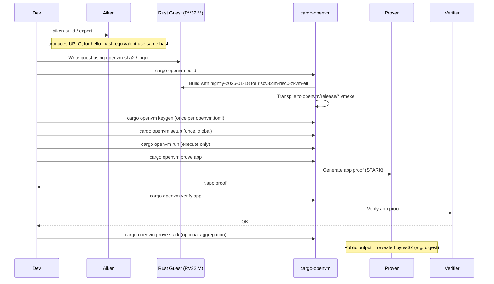
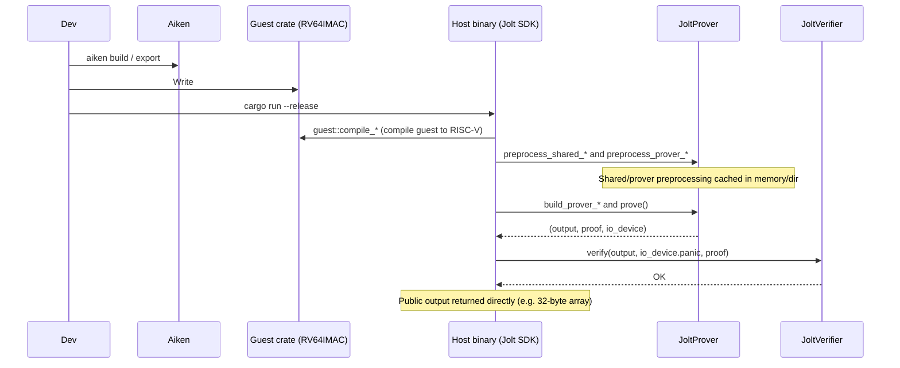

# End-to-End Demo: Aiken → zkVM (OpenVM/Jolt)

This document visualizes how an Aiken program flows through OpenVM and Jolt, provides step-by-step commands, and compares the approaches with benchmarks and trade-offs.

## High-level architecture



## Detailed flow per zkVM

### OpenVM flow (RV32IM)



### Jolt flow (RV64IMAC)



## Complete E2E demonstration

### Prerequisites

- Rust toolchain managed by rustup
- For OpenVM: `cargo-openvm` v2.0.2, `cargo openvm setup` done (keys in `~/.openvm/`)
- For Jolt: Jolt CLI optional; project deps pull from git
- Aiken v1.1.19+ (for building/testing Aiken side)

### Path 1: OpenVM - run Aiken-equivalent (hello_hash)

```bash
# 1) Verify Aiken side
cd zkVM/hello-world
aiken check  # should pass, tests hello_hash("Hello, world!") == 315f5bdb...
aiken export --module hello --name hello_hash .  # produces export/UPLC artifact

# 2) Run equivalent in OpenVM
cd ../openvm/hello-aiken  # or openvm/hello
cargo openvm run
# Expected: prints digest 315f5bdb76d078c43b8ac0064e4a0164612b1fce77c869345bfc94c75894edd3

# 3) Build, keygen (once per config), prove, verify
cargo openvm build
cargo openvm keygen  # if not already done for this toml
cargo openvm prove app
cargo openvm verify app
# app proof written (e.g. openvm-hello-aiken.app.proof)

# 4) Optional: aggregated STARK proof
cargo openvm prove stark
cargo openvm verify stark
```

### Path 2: Jolt - run Aiken-equivalent (hello_hash)

```bash
# 1) Verify Aiken side (same as above)
cd zkVM/hello-world && aiken check

# 2) Run in Jolt
cd ../jolt/hello-aiken  # or jolt/hello
cargo run --release
# Host will compile guest, preprocess, prove, verify
# Look for logs: preprocessing time, prove time, verify time, output (hex) = 315f5b...
# Proof serialized to /tmp/jolt-hello-aiken.proof
```

### Path 3: Full Aiken program via UPLC (evaluator integrated in guests)

```bash
# Decode/examine the exported artifact
cd zkVM/hello-world
aiken uplc decode -c hello_hash.flat
# (program 1.1.0 (lam i_0 [ (builtin sha2_256) [ (builtin unBData) i_0 ] ]))

# Evaluate the real artifact with the no_std evaluator
cd ../uplc-guest
cargo test  # includes differential checks against `aiken uplc eval`
cargo run --bin uplc-eval -- \
  ../hello-world/hello_hash.flat \
  --data-bytes 48656c6c6f2c20776f726c6421
# 315f5bdb76d078c43b8ac0064e4a0164612b1fce77c869345bfc94c75894edd3

# Run in OpenVM guest
cd ../openvm/hello-aiken
cargo run --bin uplc -- ../../hello-world/hello_hash.flat --data-bytes 48656c6c6f2c20776f726c6421

# Run in Jolt guest
cd ../../jolt/hello-aiken
cargo run --release --bin uplc -- ../../hello-world/hello_hash.flat --data-bytes 48656c6c6f2c20776f726c6421

# The evaluator is `no_std` and builds for riscv32im-unknown-none-elf:
cd ../../uplc-guest
cargo build --no-default-features --target riscv32im-unknown-none-elf
# Supports hashes, Data, bytearray/integer, BLS12-381 builtins.
```

## Comparison table (OpenVM vs Jolt)

| Aspect | OpenVM v2.0.2 | Jolt (a16z) |
|---|---|---|
| ISA | RV32IM | RV64IMAC |
| Proving system | Plonky3 STARKs (BabyBear), app proof + recursive aggregation to wrap | Dory-based polynomial commitments over BN254 (sumcheck/lookup), folding-style SNARK |
| Tooling | `cargo-openvm` CLI: build/keygen/setup/prove/verify/run | Jolt SDK in Rust: compile/preprocess/prove/verify all in host code |
| Guest model | `#![no_std]` with `openvm::entry!`, reveal via `openvm::io::reveal_*` | `#[jolt::provable(...)]` functions, return values become public output |
| One-time setup | `cargo openvm setup` for recursive keys (~20 min), keygen per app | No global long setup like OpenVM's internal recursive keys; preprocessing is per-program (~seconds) |
| Proof size (hello world) | App: 547 KiB, Aggregated STARK: 522 KiB | ~68.1 kB |
| Prove time (hello world, 4 cores CPU) | ~658 s (app) / ~25 min (stark) | ~11.6 s |
| Verify time (hello world) | ~0.55 s (app) / ~1 s (stark) | ~0.66 s |
| Memory (prover peak) | ~2.6 GB observed | Not measured in detail, generally efficient; varies by trace size |
| GPU support | OpenVM has GPU acceleration support in general; we tested CPU-only | Jolt has GPU paths evolving; tested CPU-only here |
| On-chain verification | Path exists via aggregation/wrapping (EVM) - targeted for recursion/wrapping to Groth16 | More complex on-chain path; recursion/folding story differs, on-chain verification less turnkey today |
| Maturity for this use case | More CLI-driven, explicit keys/flows, good for reproducible app proofs | Developer-friendly Rust API, fast iteration, small proofs, preprocessing-oriented |
| Notes for Aiken/UPLC | `no_std` UPLC evaluator integrated in guests (OpenVM/Jolt), supports full builtin set | Same; integrated with extended Data arg support |

## Trade-offs

- **Fidelity vs effort**: Porting equivalent logic (Route 1a) is fastest and matches exactly for pure functions like hash; running actual UPLC (Route 1b) gives full script fidelity. The `no_std` evaluator is implemented and integrated into OpenVM/Jolt guests with full builtin support (hashes, Data, bytearray/integer, BLS12-381).
- **Speed vs proof system**: Jolt is much faster to prove on CPU for this tiny program with smaller proofs; OpenVM's STARK path is more established for aggregation/recursion flows.
- **Tooling**: OpenVM feels more "CLI + artifacts"; Jolt feels more "library/SDK integrated into Rust build".
- **Memory**: OpenVM's app proving used ~2.6 GB for this small guest - need to watch for larger guests.
- **Future Cardano integration**: Both VMs use BN254 internally and need wrapping to BLS12-381 Groth16 for Cardano verification (see `zkVM/benchmarks.md`). OpenVM's recursion story is clearer; Jolt on-chain paths are evolving.


## E2E data flow: simplest example (hello_hash) — step by step

<details>
<summary><b>Click to expand detailed trace (OpenVM & Jolt)</b></summary>

This traces the simplest working example end-to-end: prove `hello_hash("Hello, world!")` inside OpenVM or Jolt and verify. Shows what artifacts exist, what data transforms, and which crypto primitives are used.

### Artifacts involved
| Artifact | Location | Purpose |
|----------|----------|---------|
| `hello_hash.ak` / built Aiken | `zkVM/hello-world/` | Source program (sha2_256 of Data::B) |
| `hello_hash.flat` | `zkVM/hello-world/hello_hash.flat` | Plutus Flat encoding of UPLC |
| `uplc-guest` crate | `zkVM/uplc-guest/` | no_std CEK evaluator + builtins |
| OpenVM guest/host | `zkVM/openvm/hello-aiken/` | RV32IM guest + CLI |
| Jolt guest/host | `zkVM/jolt/hello-aiken/` | RV64IMAC guest + SDK |
| Input blob/JSON | generated at runtime | program + args passed to VM |

### Step-by-step

#### 1) Aiken → UPLC → Flat
| Action | Component | Data in | Data out | Crypto/Notes |
|--------|-----------|---------|----------|--------------|
| Compile | `aiken check/build` | Aiken source | UPLC AST/terms | Type checking, desugaring |
| Export/encode | `aiken export` or flat encoder | UPLC | `hello_hash.flat` (binary) | Plutus Flat serialization |
| Verify | `uplc-guest` differential tests | `.flat` + args | matches `aiken uplc eval` | Oracle comparison |

#### 2) Prepare args & input
| Action | Component | Data in | Data out | Crypto/Notes |
|--------|-----------|---------|----------|--------------|
| Encode arg | Host CLI | `48656c6c6f2c20776f726c6421` (hex for "Hello, world!") | `Data::B(bytes)` | Simple serialization |
| Pack blob | Host CLI | `.flat` + `[Data::B]` | Binary blob `[len:u32][flat][count:u32][arg_tag][len][bytes]` or legacy format | Little-endian. Extended format supports all Data types. |
| OpenVM JSON | `--write-input` | Blob | `{"input":["0x01..."]}` | Hex-encoded for `cargo openvm` |

#### 3) Execute in zkVM guest (trace generation)
| Action | Component | Data in | Data out | Crypto/Notes |
|--------|-----------|---------|----------|--------------|
| Load input | Guest (OpenVM/Jolt) | VM input | Parsed `(flat, args)` | Decoding |
| Decode flat | `uplc-guest::flat` | Flat bytes | UPLC Program/Terms | Flat bitstream decode |
| CEK eval | `uplc-guest::machine` | Program + args | `Value::ByteString(sha256)` | CEK machine; `sha2_256` builtin via `sha2` crate |
| Reveal/output | Guest | Bytestring | Public output `315f5bdb...` | OpenVM: `reveal_bytes32`, Jolt: return `[u8;32]` |

**Crypto primitive:** SHA-256 (native in guest via `openvm-sha2` or `jolt-inlines-sha2` where possible).

#### 4) Prove
| Action | Component | Data in | Data out | Crypto/Notes |
|--------|-----------|---------|----------|--------------|
| Compile/Transpile | `cargo openvm build` / Jolt SDK | Guest Rust (RV32IM/RV64IMAC) | VM executable (`.vmexe`) or compiled guest | RISC-V toolchain |
| Preprocess/Keygen | OpenVM keygen/setup / Jolt preprocess | VM config/program | Proving/verifying keys, preprocessing data | One-time or per-program |
| Prove | `cargo openvm prove app` / `cargo run --release` | Exe + input + keys | Proof (`.app.proof` or in-memory) | **OpenVM:** STARK over execution trace (BabyBear field) + lookups. **Jolt:** Dory polynomial commitments over BN254 with sumcheck/lookups. |

#### 5) Verify
| Action | Component | Data in | Data out | Crypto/Notes |
|--------|-----------|---------|----------|--------------|
| Verify proof | `cargo openvm verify app` / Jolt verify | Proof + VK + public output | Accept/Reject | STARK verification or Dory verification. Public output checked. |

#### 6) (Optional) On-chain bridge
| Action | Component | Data in | Data out | Crypto/Notes |
|--------|-----------|---------|----------|--------------|
| Wrap | `zkVM/onchain` (`wrap-openvm`/`wrap-jolt`) | BN254 proof | BLS12-381 Groth16 proof (A/B/C) | Converts to format verifiable by `aiken/groth16` using Cardano's `bls12_381_*` builtins |
| On-chain verify | `aiken/groth16` Plutus script | Wrapped proof + VK + public inputs | Spend valid/invalid | Miller loop + final verify on BLS12-381 |

### Quick commands (copy/paste)
```bash
# Host only (fastest)
cd zkVM/openvm/hello-aiken && cargo run --bin uplc -- ../../hello-world/hello_hash.flat --data-bytes 48656c6c6f2c20776f726c6421
cd zkVM/jolt/hello-aiken && cargo run --release --bin uplc -- ../../hello-world/hello_hash.flat --data-bytes 48656c6c6f2c20776f726c6421

# OpenVM prove/verify
cd zkVM/openvm/hello-aiken
cargo run --bin uplc -- ../../hello-world/hello_hash.flat --data-bytes 48656c6c6f2c20776f726c6421 --write-input /tmp/in.json
cargo openvm build --bin uplc && cargo openvm prove app --bin uplc --exe openvm/release/uplc.vmexe --input /tmp/in.json && cargo openvm verify app --bin uplc
```

**Expected public output:** `315f5bdb76d078c43b8ac0064e4a0164612b1fce77c869345bfc94c75894edd3`

</details>
